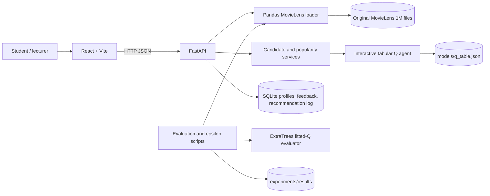

# MovieMind Architecture

## Runtime components

## Data flow

At startup, FastAPI initializes SQLite and loads the original `.dat` files. The catalog includes parsed genres, release years, rating counts, and average ratings. Recommendations filter the user's historical/app-rated movies, select from a bounded popularity pool, and apply epsilon-greedy selection with preference-affinity tie breaking. A submitted rating produces one reward/state transition, updates the shared tabular Q policy, stores the profile and feedback, and persists the Q artifact. A new recommendation request uses the updated state/policy.

## Persistence boundaries

- `moviemind.sqlite3`: per-user preference profiles, submitted feedback, transitions' old/new Q values, and recommendation history. MovieLens user IDs are validated against the loaded dataset.

The active browser profile is persisted in local storage. Interactive Q-table entries use a `user:{user_id}:{discrete_state}` key namespace inside the existing persistent model artifact; changing profiles neither clears the artifact nor applies one user's learned state/action values to another user. Existing unscoped Q-table entries remain intact for compatibility.
- `models/q_table.json`: interactive policy loaded at API startup and saved after feedback.
- `models/offline_q_table_<timestamp>.json`: separate historical offline training artifact, never loaded as the interactive agent.
- `experiments/results/`: timestamped measured evaluations and epsilon replay artifacts.

The backend API docs are available at `/docs`. The Vite development server proxies `/api` to `127.0.0.1:8000`.
