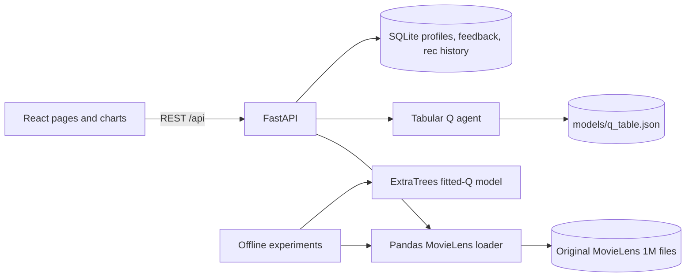

# MovieMind — Mini Project Report

## Abstract

MovieMind demonstrates an interactive movie recommender whose tabular policy is updated from explicit user ratings. A compact genre-affinity state and a bounded reward scale make the Q-learning cycle inspectable in a web application. Historical MovieLens interactions support offline analysis; they are kept separate from live demo feedback.

## Problem and objectives

Popularity-only rankings show broadly liked titles but do not adapt to an individual's explicit feedback. This project aims to (1) represent user preference as a discrete state, (2) learn action values from ratings using the Bellman update, (3) persist learning across restarts, (4) compare with a popularity baseline under chronological evaluation, and (5) make the interaction visible in a responsive full-stack interface.

## Dataset

The application uses the original GroupLens MovieLens 1M `movies.dat`, `ratings.dat`, and `users.dat` files in `data/ml-1m/`. The Pandas loader counts missing cells and duplicate rows before deduplication, converts Unix timestamps to UTC datetimes, parses genres, and extracts years. Actual inspection found 3,883 movie rows, 1,000,209 rating rows, and 6,040 user rows, with zero missing cells and zero duplicate rows. The rating distribution was 56,174 (1), 107,557 (2), 261,197 (3), 348,971 (4), and 226,310 (5). The API exposes rating and genre counts through `/api/dataset/summary`.

Movie counts by genre: Action 503, Adventure 283, Animation 105, Children's 251, Comedy 1,200, Crime 211, Documentary 127, Drama 1,603, Fantasy 68, Film-Noir 44, Horror 343, Musical 114, Mystery 106, Romance 471, Sci-Fi 276, Thriller 492, War 143, Western 68. Movies can have more than one genre, so these counts sum to more than the catalog size.

## RL formulation and algorithm

The agent is a per-profile Q table, the environment is the catalog plus explicit user feedback, a state comprises five ternary genre affinities, and an action is one unseen eligible movie. A rating maps to reward −2 through +2. The next state adjusts affinities for genres of the rated movie and clips values to [0,1]. The policy chooses a random candidate with probability epsilon and otherwise an action with maximum Q value. Epsilon decays after feedback. If no future action exists, the update uses a zero future value.

```text
Initialize Q(s,a)=0
Observe state s; choose eligible action a with epsilon-greedy policy
Receive rating; map rating to reward r
Update genre profile; observe next state s'
If terminal: target = r
Else: target = r + gamma * max_a' Q(s',a')
Q(s,a) = Q(s,a) + alpha * (target - Q(s,a))
Persist model and interaction; continue
```

The update is `Q(s,a) ← Q(s,a) + α[r + γ maxₐ′Q(s′,a′) − Q(s,a)]`. Neutral feedback contributes no direct reward, while negative and positive ratings move values in opposite directions. The user-affinity step size is deliberately bounded and smaller than a full preference reset.

## System architecture



## Offline fitted Q-learning

The advanced offline evaluator constructs chronological train-window transitions from historical per-user ratings and fits a lightweight ExtraTrees regressor to (genre-affinity state, normalized movie action) features. Fitted Q iteration refreshes targets using discounted next-state estimates and the maximum over a fixed pool of 64 movies ranked by training-window popularity. This approximates the action-value function across inputs instead of storing one value per discrete state/action pair. It is a batch experiment, not feedback from the live demo user. The bounded action pool is a teaching approximation to the full available catalog.

## Evaluation and experiment design

`experiments/evaluate.py` splits at a global timestamp quantile, learns only from the earlier partition, removes train-seen movies from each user's recommendations, and evaluates against later relevant ratings (rating ≥ 4). It reports Hit Rate, Precision, Recall at K=5 and K=10, Coverage, and observed reward for tabular Q, fitted Q, and a Bayesian-smoothed popularity baseline. It saves timestamped JSON/CSV and a chart. `experiments/epsilon_experiments.py` replays actual user-rated MovieLens titles with fixed epsilon values 1.0, 0.5, and 0.1 plus a decay strategy, reporting average reward, exploration/exploitation proportions, and a learning curve. The replay is not a counterfactual estimate of what users would rate unseen movies.

No metric is prefilled. Record actual terminal output, dataset version, split cutoff, and seed in the presentation after running on the official data files.

## Application and API

The Vite/React app provides Home, Discover, For You, Movie Details with rating, Profile, Learning Dashboard, Evaluation, and About views. The fallback poster is CSS artwork and needs no API key. FastAPI exposes health, catalog, search/filter, popularity, users, profiles, histories, recommendations, feedback, RL status and bounded Q-table access, experiment metadata, evaluation status, training status, and dataset summary routes. SQLite stores profiles, feedback, and recommendation history; the Q table is JSON persisted.

## Limitations and future work

The state sees five genres only, so affinity for other genres is not represented by the tabular state. The action pool is capped to 600 unseen popular titles for responsiveness. Historical ratings are explicit but do not contain recommendation exposure or counterfactual outcomes. Fitted-Q's next-action approximation is simplified. Future work can add logged slate exposure, richer state features, stronger offline policy evaluation, model versioning, and optional TMDB poster lookup.

## Demonstration and presentation outline

1. Introduce the problem and objectives.
2. Explain the MovieLens data and preparation.
3. Walk through state, action, reward, next state, and policy.
4. Show the Q update equation and terminal handling.
5. Rate a demo movie and inspect the returned reward, state transition, and Q change.
6. Compare measured chronological metrics and epsilon runs.
7. Discuss offline fitted Q and limitations.

Screenshots: add the Home, feedback confirmation, RL Dashboard, and Evaluation views after running the app with MovieLens installed.
